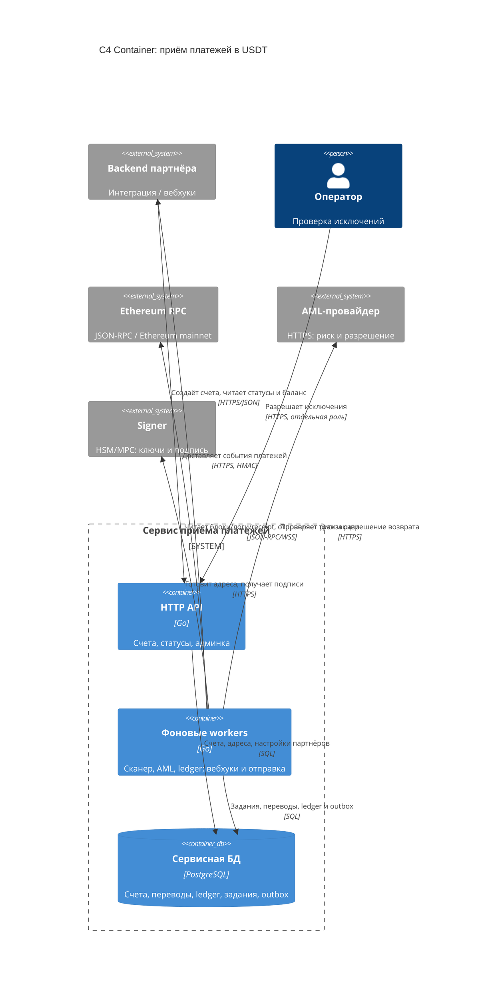
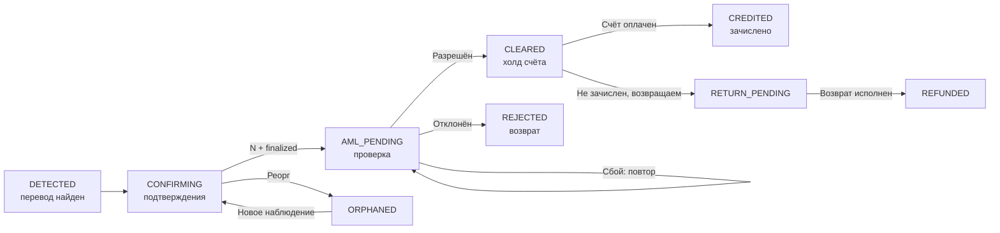
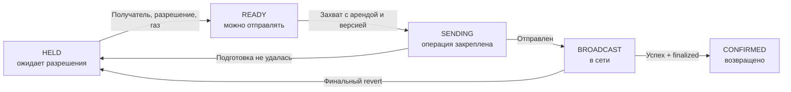

# Приём платежей в USDT

## 1. Архитектура и приём переводов

Сервис принимает USDT в Ethereum mainnet и хранит принятые средства. На счёт выдаём отдельный адрес без повторного использования. Срок оплаты - 30 минут, доплаты разрешены. Зачисляем после финальности, разрешения AML и оплаты счёта.

**Основной поток.** Scanner (поиск перевода) → Deposit (подтверждения и финальность) → AML → Settlement (расчёт) → Ledger + Outbox → Webhook партнёру.

**Устройство сервиса.** API и обработчики масштабируются отдельно, но используют общую Go-кодовую базу и PostgreSQL. Распределение суммы, проводки, статус и outbox фиксируем одной ACID-транзакцией; внешние вызовы выполняем вне неё. Оператор имеет отдельную роль и аудит, баланс вручную не редактируется.

**Обнаружение и финальность.** Сканируем `eth_getLogs`, сохраняем переводы и курсор атомарно. WebSocket ускоряет обнаружение, второй RPC проверяет цепочку; расхождение останавливает расчёты. Проверяем `chain_id=1`, официальный контракт USDT, `Transfer` на наш адрес и успешный канонический receipt. Ждём 12 подтверждений и `finalized` - обычно около 15 минут. До этого проводок нет. При реорге пересканируем от общего предка и перепроверяем перевод. AML привязан к `(payment_id, observation_version)`; проверяем версию в транзакции зачисления, устаревшие ответы игнорируем. Повторное включение сохраняет payment_id, меняет observation_version. ([USDT](https://tether.to/en/supported-protocols/), [RPC](https://ethereum.org/developers/docs/apis/json-rpc/), [финальность](https://ethereum.org/roadmap/single-slot-finality/))

**API и ключи.** `POST /invoices`, `GET /invoices/{id}`, `GET /balance` доступны только своему партнёру по API-ключу. Повтор создания с тем же ключом идемпотентности возвращает счёт; другое тело даёт 409. GET показывает суммы, комиссию, AML, возвраты, версию и окончательность расчёта. Сервис подписи (signer) создаёт Ethereum-адреса (EOA). БД хранит адрес и key_id, HSM/MPC - ключи с восстановлением и ограничениями подписи.

**Уведомления и отправка.** Вебхуки сообщают об изменении счёта, окончательном расчёте и компенсациях. Outbox повторяет доставку до 2xx; после 72 часов ошибок нужен ручной повтор. Подпись - HMAC-SHA256 тела и timestamp; дубли различаем по event_id и версии из GET. HTTPS обязателен, внутренние адреса запрещены. У выплаты закреплены сумма и номер транзакции (nonce). После потери lease другой worker продолжает ту же операцию. Все подписанные версии сохраняем до отправки и сверяем. Повторы и fee bump сохраняют nonce, получателя и сумму; новый nonce выдаём после финального revert.

**Рост нагрузки.** При 1 млн счетов в день и 10% оплат нужно около 300 тыс. транзакций: вход, ETH-пополнение, сбор USDT в treasury (общий кошелёк). Первыми ограничат бюджет и ёмкость L1, signer. Сканирование общее; масштабируем обработчики, ограничиваем AML, делим историю. Контракты экономят газ; L2 согласуем с продуктом.

<!-- pagebreak -->

## 2. Статусы и учёт денег

**Счёт и перевод - разные сущности.** Счёт проходит `OPEN → PARTIAL → PAID` или сразу `OPEN → PAID`. В дедлайн неоплаченный счёт становится `SETTLING`, затем `PAID` или `EXPIRED`. `PAID` разрешает выдачу товара и доплаты до номинала из блоков до дедлайна. После сканирования финального блока за дедлайном и AML всех своевременных переводов атомарно фиксируем `settlement_final=true`, время `settled_at`, gross/fee/net и событие `invoice.settled`. Поздние поступления учитываем отдельно, возвращаем после AML. Компенсации оформляем отдельными проводками и событиями.

`CLEARED` - перевод разрешён AML, но удерживается до оплаты счёта. При сбое AML повторяем проверку, через 15 минут поднимаем алерт. `REJECTED` сохраняется после возврата. Ждём AML более ранних переводов, обрабатываем их по порядку блоков, транзакций и логов. Зачисленное не перераспределяем, излишек возвращаем.

Неопределённая отправка остаётся в `SENDING/BROADCAST` до сверки. Возврат один на перевод, включая незачисленный остаток после `CREDITED`.

**Точность денег.** В Go: USDT - `int64` (microUSDT), ETH - `big.Int` (wei). В PostgreSQL: USDT - `BIGINT`, ETH и общая колонка ledger - `NUMERIC(78,0)` (ADR 7). API - строки. `uint256` и умножения - через `big.Int`. Выход USDT за `0..MaxInt64` изолирует перевод с алертом; зачисление ждёт ручного разбора и проверки диапазона. Проводки положительны и неизменяемы; дебет равен кредиту по валюте.

| Событие: 100 USDT, комиссия 1% | Дебет | Кредит |
| --- | --- | --- |
| Вход финален, AML ещё проверяет | Депозитный актив: 100 | Холд: 100 |
| Счёт оплачен | Холд: 100 | Доступный долг: 99; доход: 1 |
| AML отказ / истёкшая недоплата | Холд: 100 | Долг по возврату: 100 |
| Возврат финален | Долг по возврату: 100 | Депозитный актив: 100 |
| Сбор средств в treasury | Актив treasury: 100 | Депозитный актив: 100 |
| Вывод: резервирование | Доступный долг: 99 | Резерв вывода: 99 |
| Вывод: финальный успех | Резерв вывода: 99 | Актив treasury: 99 |
| Вывод: окончательная отмена | Резерв вывода: 99 | Доступный долг: 99 |

**Баланс.** Доступный баланс - сальдо доступного долга; общий долг включает резерв вывода. Резервируем под блокировкой при достаточном балансе. Отменяем до подписи или после доказанного неисполнения всех версий. Уникальность операций и версия наблюдения предотвращают дубли.

**Глубокий реорг.** Останавливаем расчёты и сверяем deposit и treasury. Корректируем фактические проводки без двойного сторно сбора. По зачисленной части сторнируем комиссию, признаём убыток на net, долг партнёру сохраняем. Холд или неподписанный возврат остатка отменяем. Подписанный возврат сохраняет обязательство до доказанного неисполнения всех версий. Вернувшийся вход восстанавливает актив, доход и отменённые обязательства, компенсирует убыток; зачисления и исполненные возвраты не повторяем. Финансовая версия различает смены каноничности, повтор идемпотентен. Потери покрывает внесённый капитал.

**Сверка.** Ежедневно по валюте на общей finalized-высоте: активы = холды + долг партнёрам + возвраты + капитал + чистый доход − чистые убытки. Карантин и нефинальные движения отдельно; необъяснённое расхождение - стоп.

<!-- pagebreak -->

## 3. Продуктовые правила и решения

**Недоплата.** Партнёр выбирает допуск 0..3%, фиксируем его в счёте. Без допуска при 97 из 100 клиент видит «доплатить 3» и срок, партнёр - `PARTIAL` и холд 97, поддержка - переводы, AML и дедлайн. С допуском 3% получаем `PAID`: скидку несёт партнёр, комиссия берётся с 97. Доплаты до номинала увеличивают gross, fee и net; истёкшую недоплату возвращаем без комиссии.

**AML и возврат.** Газ оплачивает сервис, возвращаем USDT полностью. На `Transfer.from` отправляем только при безопасном маршруте. Для контракта или биржи маршрут подтверждает оператор; иначе `HELD`. Смена адреса требует проверки и доказательства владения источником. Приём и возврат имеют разные AML-политики. При AML-запрете или заморозке USDT сохраняем долг и обращение. ([Tether](https://tether.io/news/tether-introduces-new-policy-to-strengthen-ecosystem-security/))

**Газ и ETH.** Резерв газа - `gas_limit × max_fee_per_gas`; для версий одного nonce берём максимум, для разных - сумму. Пополняем только дефицит ETH: резерв минус финальный баланс и ожидаемые пополнения, ещё не включённые в него. Пополнение переводит актив из treasury на депозитный адрес; отправка ждёт его финальности. Каждый финальный receipt, включая `revert`, списывает расход `gasUsed × effectiveGasPrice`; остаток резерва освобождаем. Реорг расхода компенсируем по финансовой версии.

**Сроки и лимиты возврата.** Если газ дороже суммы, обычный разрешённый возврат откладываем максимум на 7 дней от создания. До подписи проверяем суточный бюджет газа и квоты по источнику и счёту, включая переводы на старые адреса. Превышение квот при массовых микропереводах даёт `HELD`, долг сохраняем. Для `HELD` и внешних блокировок срок отправки не обещаем: владелец решает или эскалирует за 7 дней, затем пересматривает ежедневно. Нехватку бюджета устраняет за рабочий день; просрочка останавливает новые счета. Клиент видит причину и следующий шаг.

**Комиссия.** Ставка партнёра фиксируется в счёте. Для общей суммы зачисления: `fee = floor(gross × bps / 10000)`, где 100 bps = 1%. Комиссия доплаты равна разнице общей комиссии до и после неё: дробление не меняет результат. В отчёте gross - зачислено до комиссии, fee - комиссия, net = gross − fee; отдельно показываем получено, холд и возвращено. Возвращаемая часть без комиссии.

| Кому | Метрики и назначение |
| --- | --- |
| Партнёр | Net-оборот: выручка; доступный баланс: вывод; доля PAID по когорте: конверсия; p95 до зачисления: ожидание; холды и возвраты: незавершённые деньги. |
| Команда | Отставание сканера: сеть; p95 AML: проверка; возраст заданий: зависания; запас ETH: газ; расхождение ledger и сети: контроль денег. |

**Первая версия: две недели, два разработчика.** Один делает API и ledger, второй - обработчики; вместе проверяют дубли и сбои. Начинаем с моков сети, AML и signer. Пилот требует готовых интеграций, капитала, сверки и аудита; возвраты и выводы разрешает оператор. Кабинет, авто-выводы, сложные тарифы и L2 откладываем ради проверки денег и восстановления.

### Журнал решений

| № | Решение и компромисс |
| --- | --- |
| 1 | Модульный монолит с PostgreSQL вместо микросервисов: финансовые изменения и outbox атомарны, распределённые транзакции не нужны. |
| 2 | Сканирование с курсором вместо одной подписки: разрыв WebSocket не теряет переводы; второй RPC выявляет расхождения. |
| 3 | 12 подтверждений и finalized вместо одного числа блоков: защищаем зачисление ценой ожидания и остановки при потере финальности. |
| 4 | Отдельный EOA и готовый signer вместо общего адреса или своих контрактов: проще сопоставление, меньше рисков ключей; цена - газ L1. |
| 5 | **Пересмотр:** сначала зачислял недоплату после AML. Истечение счёта без выдачи товара потребовало холда до PAID и возврата без отмены дохода. |
| 6 | Газ оплачивает сервис вместо удержания USDT у клиента: полный возврат требует резерва и контроля бюджета. |
| 7 | int64 для USDT проще единого big.Int. В ledger общий NUMERIC(78,0) вместо колонок по валютам: единая схема проводок и сверки. Домен ограничивает суммы и балансы USDT диапазоном 0..MaxInt64; CHECK по валюте ограничивает проводки. |
