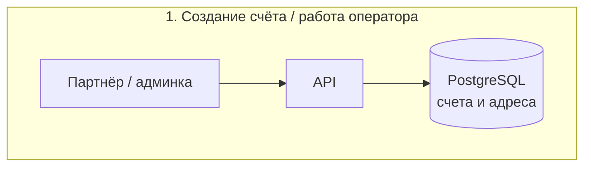
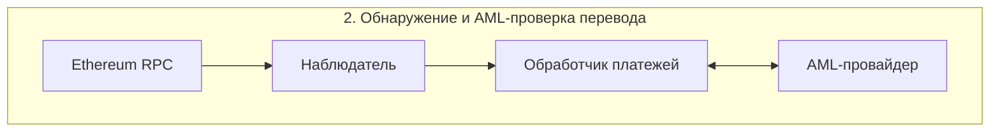
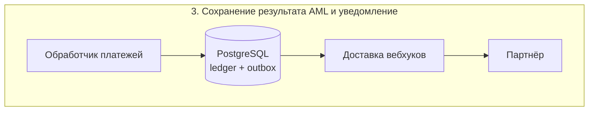
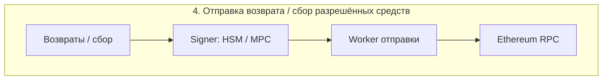
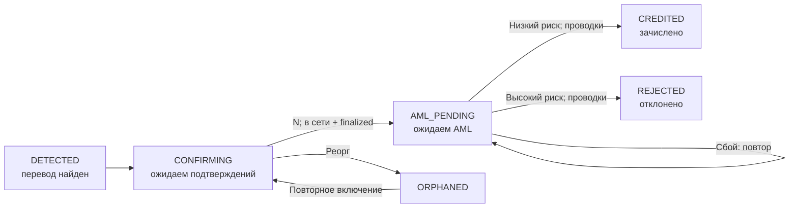
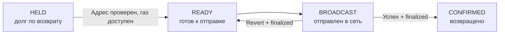

# Приём платежей в USDT

## 1. Архитектура и приём переводов

**Допущения.** Только Ethereum mainnet и USDT; сервис хранит средства, баланс партнёра является обязательством сервиса. Счёт действует 30 минут; отдельный адрес на счёт никогда не переиспользуется. Один счёт допускает несколько переводов. Вывод партнёру - отдельный процесс, за рамками первой версии. AML оценивает конкретный перевод и источник средств, а не только адрес.

**Компоненты и надёжность.** На схемах одна общая PostgreSQL. Go-монолит с модулями API, наблюдателя, платежей/ledger, возвратов и уведомлений; API и фоновые процессы запускаются отдельно. БД - источник истины; задания и outbox (очередь событий) сохраняются вместе с изменениями. Внешние вызовы выполняются вне транзакции БД; результат применяется под блокировкой перевода с проверкой состояния. После сбоя worker повторяет работу; уникальные ключи исключают повторный денежный эффект.

**API и адреса.** `POST /invoices`, `GET /invoices/{id}`, `GET /balance`: API-ключ определяет партнёра, каждый запрос ограничен его `partner_id`. Создание уникально по `(partner_id, idempotency_key)`; тот же запрос возвращает прежний счёт, иное тело - HTTP 409. Адреса EOA заранее готовит изолированный signer; API атомарно забирает свободный адрес. В проде ключи только в HSM/MPC с резервным восстановлением, лимитами и разрешёнными операциями; в БД адрес и идентификатор ключа. Приложение не получает seed/private key. После AML разрешённые средства собираются в treasury, отклонённые остаются на депозитном адресе до возврата.

**Обнаружение.** Последовательно сканируем `eth_getLogs` диапазонами блоков; курсор сохраняем атомарно с найденными переводами. WebSocket лишь ускоряет пробуждение. Проверяем `chain_id=1`, адрес контракта **`0xdAC17F958D2ee523a2206206994597C13D831ec7`**, событие `Transfer`, наш получатель, положительную сумму, успешный receipt (`status=1`) и совпадение канонического `blockHash`. Название токена не используется. Адрес подтверждён [Tether](https://tether.to/en/supported-protocols/); методы и поля - [Ethereum JSON-RPC](https://ethereum.org/developers/docs/apis/json-rpc/).

**Подтверждения и реорги.** Число подтверждений = `head - block + 1`; порог N=12 - допущение. В симуляторе достаточно N; в сети денежные проводки дополнительно ждут блока `finalized`, задержку показываем клиенту. Сохраняем hash/parentHash блоков, при расхождении откатываем наблюдения до общего предка и пересканируем. До порога проводок нет. Идентичность перевода: `(chain_id, tx_hash, порядковый номер лога в receipt)`; глобальный `logIndex` может измениться при повторном включении. Отдельно храним наблюдение `(blockHash, logIndex)`. Повторное включение оживляет прежний перевод. Реорг после финализации - инцидент: стоп зачислений/выводов, сверка и компенсирующие записи; уже выведенную сумму покрывает резерв сервиса, история не удаляется.

**Вебхуки.** Outbox создаётся в одной транзакции со статусом и ledger. Доставка как минимум один раз: HTTP 2xx завершает попытки, иначе backoff с jitter до 72 часов, затем очередь ошибок и ручной replay. `event_id` и версия счёта позволяют партнёру убрать дубли/старые события; актуальное состояние доступно через GET. Подпись HMAC-SHA256 по timestamp и исходному телу, отдельный секрет партнёра, окно 5 минут, ротация. Только HTTPS; запрещены внутренние адреса назначения.

**Масштаб.** 1 млн счетов/сутки ≈ 12/с; переводов может быть меньше. Первые ограничения - RPC/AML, газ EOA и рост таблиц. Один сканер всех событий USDT вместо RPC на каждый адрес; локальное сопоставление получателей, адаптивные диапазоны, резервный RPC. Далее - отдельные пулы workers, лимиты AML, партиции истории и пакетная сверка. Для миллиона оплат в сутки L1 дорог и ограничен пропускной способностью: согласуем L2/другую сеть либо контрактные адреса со сбором средств после аудита.

<!-- pagebreak -->

## 2. Статусы, ledger и возвраты

**Три сущности.** Счёт - требование на сумму; платёж - один входящий перевод; возврат - отдельное обязательство и операция отправки. У счёта `OPEN → PARTIAL → PAID`, `OPEN/PARTIAL → EXPIRED`; прямая `OPEN → PAID` допустима. Оплата определяется суммой AML-разрешённых переводов. Срок проверяем по времени блока поступления: перевод, пришедший вовремя, после AML может перевести `EXPIRED → PARTIAL/PAID`. Каждый перевод проверяется отдельно; смешанный счёт может иметь и зачисление, и возврат.

После `REJECTED` создаётся возврат `HELD`; отклонённый платёж остаётся `REJECTED`. Поздний перевод сразу после подтверждений учитывается в холде и идёт на ручную обработку без автоматического зачисления. AML при недоступности остаётся `AML_PENDING`: повторы с backoff, после 15 минут сигнал поддержке, автоматического разрешения нет.

**Двойная запись.** Суммы - целые единицы: 1 USDT = 1 000 000 единиц, PostgreSQL `NUMERIC(78,0)`, Go `big.Int`; API передаёт десятичные строки. Дебет увеличивает активы/расходы, кредит - обязательства/доход. В каждой проводке сумма дебетов равна сумме кредитов в одной валюте; USDT и ETH учитываются раздельно.

| Событие; пример 100 USDT, комиссия 1% | Дебет | Кредит |
| --- | --- | --- |
| Подтверждённый перевод, до ответа AML | Депозитный актив: 100 | AML-холд: 100 |
| AML разрешил: доступно партнёру | AML-холд: 100 | Долг партнёру: 99; доход сервиса: 1 |
| AML отклонил: создан возврат | AML-холд: 100 | Долг по возврату: 100 |
| Возврат подтверждён в сети | Долг по возврату: 100 | Депозитный актив: 100 |
| Сбор разрешённых средств в treasury | Актив treasury: 100 | Депозитный актив: 100 |

До подтверждений хранится только наблюдение. Создание/отправка возврата не списывает USDT из учёта: до финального успеха обязательство сохраняется. Баланс партнёра берётся из ledger; холд и возвраты в него не входят. Ежедневно сверяем активы ledger с on-chain остатками, отдельно объясняя нефинализированные входящие/исходящие операции; для данного потока активы USDT = холд + долг партнёрам + долг по возвратам + доход сервиса.

**Защита от дублей.** В одной транзакции: блокировка платежа, проверка статуса, сбалансированные записи, новый статус и outbox. Уникальны `(payment_id, operation_type)` и AML-возврат по `payment_id`. Балансы обновляются под блокировкой счетов в едином порядке; повтор или два workers не создают второй эффект. Ledger неизменяем: исправление только обратной проводкой со ссылкой на исходную.

**Газ и отправка.** Отдельный ETH-кошелёк сервиса пополняет депозитный адрес под оценку `gas_limit × max_fee_per_gas`, с лимитом расходов. Перемещение ETH между своими адресами меняет только активы; фактически потраченный газ: Дт расход газа / Кт актив ETH. Сервис оплачивает и пополнение, и возврат; отправителю возвращается вся сумма USDT, комиссия за отклонённый платёж нулевая. При нехватке ETH или превышении лимита возврат остаётся `HELD`, причина видна поддержке.

Signer сохраняет nonce и подписанную транзакцию **до** broadcast. Неопределённый ответ RPC - поиск по hash и повтор тех же байтов; повышение цены использует тот же nonce и получателя. Потеря блока отправки сохраняет `BROADCAST` и запускает сверку; новый nonce разрешён лишь после доказанного финального revert. Проверяем receipt и фактическое событие перевода USDT. `READY` выдаётся только после проверки получателя и финансирования газа.

<!-- pagebreak -->

## 3. Продукт и журнал решений

**Недоплата 3%.** По умолчанию допуск 0%: для счёта на 100 клиент видит «получено 97, доплатить 3»; партнёр - `PARTIAL`, фактическую сумму и её net-зачисление после AML; поддержка - переводы, AML, недостающую сумму и срок. Товар отдаётся только при `PAID`. Партнёр может включить допуск до 3%: после AML счёт станет `PAID`, но расчёт и комиссия идут с 97, скидку несёт партнёр. Допуск и тариф фиксируются при создании счёта. Доплаты разрешены до срока; поздние поступления - ручное решение. Переплата зачисляется по факту с отдельным признаком; решение о возврате излишка принимает партнёр.

**AML и адрес возврата.** Сервис платит газ: клиент не выбирает провайдера AML, а партнёр не получил деньги. Малые суммы с газом дороже перевода остаются долгом `HELD`: ждём более дешёвого газа либо ручного решения, без списания в доход; клиент видит причину и срок следующего пересмотра. Возвращать автоматически на `tx.from` нельзя: это может быть relayer, контракт или горячий кошелёк биржи. Проверяем источник по событию и данным AML; личный кошелёк подтверждает владение подписью, для биржи поддержка согласует маршрут с биржей и проверяет доказательства платежа. Повторная AML-проверка получателя обязательна; запрет на отправку сохраняет `HELD` и уходит на ручное рассмотрение.

**Комиссия.** Персональный процент в базисных пунктах (100 bps = 1%), без фиксированной части: доплаты не создают повторный фиксированный сбор. Для каждого разрешённого перевода `fee = floor(gross × bps / 10000)`, `net = gross - fee`; дробный микродоллар остаётся партнёру. Версия тарифа сохраняется в счёте, её изменение не меняет старые счета. В отчёте отдельно gross, ставка, fee, net и AML-возвраты; сверка привязана к payment_id и проводкам. Отклонение AML не создаёт дохода от комиссии.

| Кому | 5 метрик и назначение |
| --- | --- |
| Партнёр | Gross/fee/net - сверка выручки; доступный баланс - планирование вывода; доля PAID по когорте счетов - конверсия; p95 от обнаружения до зачисления - ожидания клиентов; суммы PARTIAL/AML_PENDING/возвратов - деньги, требующие внимания. |
| Внутренняя команда | Отставание сканера/финализации - задержка сети; p95 и ошибки AML - зависшие проверки; возраст/число HELD и запас ETH - риск задержки возвратов; возраст/ошибки outbox - потеря уведомлений; расхождения on-chain/ledger - денежный инцидент, допустимое необъяснённое значение 0. |

**Две недели, два разработчика.** Выпускаем ограниченный пилот: одна сеть/токен, API, PostgreSQL-ledger, RPC-сканер, один AML, внешний готовый signer, вебхуки и простые операторские команды с аудитом. Первый разработчик ведёт API/ledger/уведомления; второй - сеть/AML/signing; вместе проверяют дубли, реорги, сбои и восстановление из backup. Возвраты создаются автоматически, проверка адреса и разрешение отправки выполняются оператором. Ограничиваем объём/суммы, настраиваем алерты и ежедневную сверку. Кабинет, авто-выводы, сложные тарифы, L2 и собственную инфраструктуру ключей откладываем. Без готового signer запускаем sandbox; боевые средства не принимаем.

### Журнал решений

| № | Выбор, альтернатива и основание |
| --- | --- |
| 1 | Модульный монолит и задания PostgreSQL. Микросервисы/брокер отклонены для пилота: два разработчика, важнее атомарность денег и событий; workers масштабируются отдельно. |
| 2 | Сканирование с курсором; подписка только как ускоритель. Только WebSocket отклонён: после разрыва соединения события нужно восстановить из блоков. |
| 3 | **Пересмотр:** сначала N=12 считал достаточным для прод-зачисления. Разбор реорга уже после AML показал риск расходования исчезнувших средств; добавил `finalized`, приняв более долгую оплату. |
| 4 | EOA на счёт и внешний signer. Общий адрес затрудняет сопоставление одинаковых сумм; депозитные контракты требуют аудита. Цена выбора - газ пополнения и сбора, поэтому L1-пилот ограничен. |
| 5 | Ledger и outbox в одной транзакции. Изменяемые балансы без журнала и отправка вебхука до commit отклонены: трудно доказать происхождение денег и восстановиться после сбоя. |
| 6 | Газ AML-возврата оплачивает сервис. Удержание его из USDT отправителя отклонено: спорная итоговая сумма и обменный курс; лимиты и ручная обработка малых сумм контролируют расходы. |
| 7 | Процент и сохранённая версия тарифа. Фиксированная комиссия за перевод отклонена: дробление оплаты меняет цену; тариф счёта даёт воспроизводимый расчёт и отчёт. |
